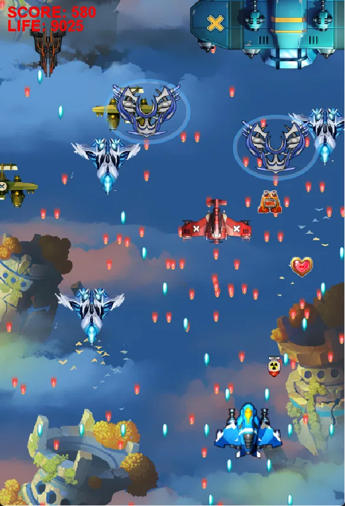

# 飞机大战 (Aircraft War)


[](LICENSE)
[](https://github.com/pmsjl/AircraftGame/actions/workflows/ci.yml)

基于 Java Swing 的纵向卷轴射击游戏，哈尔滨工业大学（深圳）软件构造课程（Java / OOP）综合实验项目。

## 快速开始

- **JDK**：17+
- **IDE**：IntelliJ IDEA — 打开项目根目录，运行 `src/edu/hitsz/application/Main.java`
- **依赖**：无第三方库 —— 纯 Java / Swing 工程，无需 Maven、Gradle 或外部 JAR

> 图片与音频按 `src/images`、`src/videos` 的相对路径读取，**请以项目根目录为工作目录**运行。

### 命令行运行（可选）

```bash
# 编译（src 与 test 一并编译到 build/）
javac -encoding UTF-8 -d build $(find src test -name '*.java')

# 启动游戏
java -cp build edu.hitsz.application.Main

# 运行自测
java -cp build edu.hitsz.aircraft.HeroAircraftTest
```

## 游戏简介

<p align="center">
  
</p>

玩家通过拖拽鼠标控制英雄机，在 512×768 的战场上迎击不断来袭的敌机。击落敌机可获得分数，并有概率掉落道具。随着时间推移，敌机会越来越强。得分达到阈值时 Boss 出现。英雄机 HP 归零则游戏结束，分数存入排行榜。

### 敌机类型（8 种）

| 敌机 | 分数 | 特点 |
|------|------|------|
| **MobEnemy**（普通） | 10 | 不射击，不丢道具，冻结后永久静止 |
| **EliteEnemy**（精英） | 20 | 直线射击，30% 掉率掉落道具，冻结 4s |
| **ElitePlusEnemy**（精锐） | 25 | 双发子弹，可掉落炸弹道具，冻结 3s |
| **EliteProEnemy**（王牌） | 30 | 散射子弹，可掉落冰冻道具，首次炸弹免疫（扣 35 HP 保底 1 HP），冻结期间减速 50%（5s） |
| **BossEnemy**（Boss） | 200 | 环射 20 发子弹，5000 HP，必掉 3 个道具，冰冻免疫，炸弹免疫 |
| **ShieldEnemy**（护盾） | 35 | 50 HP 护盾吸收伤害，炸弹可无视护盾秒杀 |
| **DodgeEnemy**（闪避） | 25 | 被命中时横向闪避 5 帧 |
| **KamikazeEnemy**（神风） | 20 | 高速向下冲锋，死亡时向 8 方向射出弹幕 |

### 道具系统（5 种）

| 道具 | 效果 |
|------|------|
| **BloodProp**（加血） | 回复 30 HP |
| **BombProp**（炸弹） | 清除所有非 Boss 敌机及全部敌方子弹，ElitePro 扣 35 HP |
| **BulletProp**（火力） | 切换为散射射击，持续 2s |
| **BulletPlusProp**（超级火力） | 切换为环射，弹数翻倍，持续 2s |
| **FreezeProp**（冰冻） | 冻结所有敌机及敌方子弹（Boss 免疫），时间因敌机类型而异 |

### 难度系统

| 难度 | Boss | 难度递增 | 分数倍率 | 初始生成间隔 |
|------|------|----------|----------|-------------|
| **简单** | 无 | 无 | 1.0× | 12 帧 |
| **普通** | 500 分首出，之后每 +3000 分 | 每 30s：生成间隔 ×0.92、敌机速度 ×1.10、敌机血量 ×1.15 | 1.5× | 8 帧 |
| **困难** | 同普通 | 普通基础上 + 英雄射击间隔 ×0.95、敌机射击间隔 ×0.92，Boss HP 每次 ×1.30 | 2.0× | 6 帧 |

## 操作方式

- **拖拽鼠标**：控制英雄机移动
- 英雄机自动持续射击，无需按键

## 设计模式

本项目作为 OOP 设计模式教学案例，实现了 7 种经典设计模式：

| 模式 | 应用场景 |
|------|----------|
| **模板方法** | `Game.action()` 为 `final` 主循环骨架，三个难度子类覆盖 hook 方法（`shouldSpawnBoss`、`onProgressTick` 等） |
| **观察者** | `BombObserver` / `FreezeObserver` 接口——道具触发时 `Game` 遍历所有敌机/子弹调用对应方法，各类型按自身规则响应 |
| **策略** | `ShootStrategy` 接口含 4 种实现（直线/散射/环射/空），飞机组合策略对象并委托射击 |
| **工厂方法** | `EnemyFactory` 接口，每种敌机一个工厂类，`Game` 按权重随机选择生成 |
| **简单工厂** | `PropFactory.createProp(type, x, y)` 按字符串键返回对应道具子类 |
| **单例** | `HeroAircraft` 双重检查锁定获取唯一实例 |
| **DAO** | `RecordDao` 接口 + `RecordDaoImpl` 封装排行榜的序列化存取 |

## 项目结构

```
AircraftWar/
├── src/
│   ├── edu/hitsz/
│   │   ├── aircraft/        # 飞机基类 + 英雄机单例
│   │   ├── application/     # 入口、菜单、Game 模板、难度子类、排行榜
│   │   ├── basic/           # 飞行物体根基类
│   │   ├── bullet/          # 子弹（英雄/敌方，含冻结逻辑）
│   │   ├── dao/             # 排行榜持久化（Java 序列化）
│   │   ├── enemy/           # 8 种敌机实现 + Explosive 接口
│   │   ├── factory/         # 敌机工厂 + 道具简单工厂
│   │   ├── observer/        # 观察者接口（炸弹/冰冻）
│   │   ├── prop/            # 5 种道具
│   │   ├── record/          # 玩家记录 POJO
│   │   ├── strategy/        # 射击策略（直线/散射/环射/空）
│   │   └── utils/           # 音频播放线程
│   ├── images/              # 游戏贴图（PNG/JPG）
│   └── videos/              # 音效 / BGM 文件（WAV）
├── test/                    # 自测用例（无 JUnit，自定义 main() 断言）
├── lib/                     # （预留，当前无外部依赖）
├── uml/                     # PlantUML 设计图（10 张）
└── .github/workflows/ci.yml # GitHub Actions：自动编译 + 运行测试
```

## UML 图

`uml/` 目录下提供了 10 张 PlantUML 设计图，覆盖：

- 继承体系（Inheritence）
- 模板方法模式（TemplateMethodPattern）
- 观察者模式（ObserverPattern）
- 策略模式（StrategyPattern）
- 工厂方法模式（FactoryMethodPattern）
- 简单工厂模式（SimpleFactoryPattern）
- 单例模式（SingletonPattern）
- DAO 模式（DaoPattern）

使用 PlantUML 插件或在线服务 (plantuml.com) 渲染。

## 测试

`test/edu/hitsz/aircraft/HeroAircraftTest.java` — 轻量级自测用例。工程未引入 JUnit，采用自定义断言与 `main()` 入口（运行方式见「快速开始 · 命令行运行」），覆盖英雄机射击、Buff 版本控制、HP 操作等。每次 push / PR 由 GitHub Actions 自动编译并执行。

## 致谢

- 哈尔滨工业大学（深圳）《软件构造》课程：提供游戏基础框架与课程素材，本项目仅供教学与学习参考。
- 新增敌机（护盾 / 闪避 / 神风）贴图参考 [MillionthVector](http://millionthvector.blogspot.de) 的素材重绘，遵循 [CC BY 4.0](https://creativecommons.org/licenses/by/4.0/)。

## 许可

[MIT](LICENSE) © 2026 pmsjl
